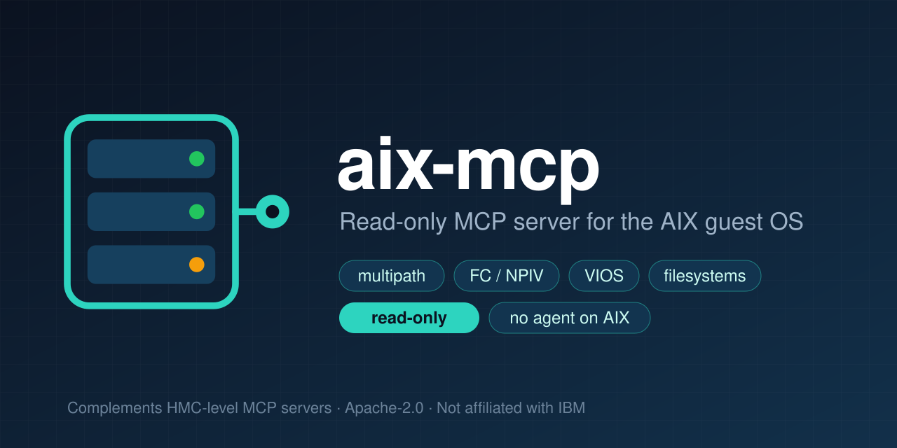
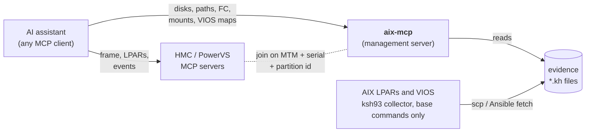

<!-- mcp-name: io.github.vyasdx/aix-mcp -->
<p align="center">
  
</p>

<p align="center">
  <a href="https://github.com/vyasdx/aix-mcp/actions/workflows/ci.yml"></a>
  <a href="LICENSE"></a>
  <a href="https://pypi.org/project/aix-mcp/"></a>
  
  
  
  
</p>

<p align="center">
  <b>Ask your AI assistant what is happening <i>inside</i> your AIX LPARs and VIOS,<br>
  without giving it a shell.</b>
</p>

---

**aix-mcp** is an open-source [Model Context Protocol](https://modelcontextprotocol.io) server for
the AIX guest OS. It turns read-only evidence from your hosts into typed, filterable answers about:

* disks and multipath;
* FC and NPIV;
* VIOS mappings;
* filesystems;
* **performance history**: CPU against entitlement, memory, paging and disk busy.

Any MCP client can use it: an IDE assistant, a chat app or your own agent. It never changes
anything.

> Not affiliated with, endorsed by or supported by IBM. AIX, PowerVM and IBM Power are trademarks
> of IBM Corp.

## What it looks like

> **You:** Any storage problems across the estate I should know about before tonight's change?
>
> **Assistant** *(calls `aix_findings` with `min_severity: "medium"`)*: Two hosts have evidence, collected about 2 hours ago.
> On **host-01**:
> - **hdisk1** (datavg) has 1 of 2 paths Failed, so it is running on a single path.
> - **fscsi1** reports link **Down** to target port `500507680130aa02`, which is probably the same cause.
> - **/data01** is 97% full.
>
> On **vios-01**, **vfchost2** (client 7, host-07) is **NOT_LOGGED_IN**.
>
> One check, `bootinfo -s hdisk2`, did not answer in time, so hdisk2's size is unknown, not zero.

Under the hood, the agent gets compact typed JSON like this:

```json
{
  "schema_version": "1",
  "total": 2, "returned": 1, "hosts_considered": 2,
  "next_cursor": "eyJvIjogMSwgImsiOiAiOWU3MGNlZDJjODFiMmU0NCJ9",
  "items": [{
    "host": "host-01", "disk": "hdisk1", "vg": "datavg", "driver": "AIX PCM",
    "paths": 2, "enabled": 1, "failed": 1, "other": 0, "optimised": 1,
    "collected_at": "20261120T101500Z", "evidence_age_hours": 1.9
  }]
}
```

## Why a guest-OS layer

HMC-level and PowerVS-level MCP servers see the **frame**: managed systems, partitions, profiles,
virtual adapters and serviceable events. They don't see **inside** AIX:

* the state of each disk path;
* `hcheck_interval` and `fc_err_recov`;
* ALUA optimised paths;
* full filesystems;
* stale NFS mounts;
* which checks hung.

aix-mcp is that inside view. Every answer carries the **LPAR identity** (machine type-model,
serial and partition id), so an agent can join it with HMC-level data about the same partition.



## Safety model

| | |
|---|---|
| **Read-only by construction** | No tool runs a command. In v0.1 the server only reads collector files, and every tool is annotated `readOnlyHint`. |
| **Nothing installed on AIX** | One ksh93 script that uses base AIX commands. No Python, agent or daemon on the host. |
| **Allowlisted commands** | The collector refuses anything that is not on its list. The full list is in [docs/commands.md](docs/commands.md). |
| **No root over SSH** | Live collection (v0.2) logs in as a non-root user whose key is tied to a forced command: a fixed set of verbs, no shell, no forwarding. One exact sudo rule runs the storage collector; performance history needs no root at all. The MCP server never holds the SSH key. |
| **Never stalls a host** | Each command runs under a watchdog, and a hung `df` on a dead NFS mount is abandoned and marked `MISSING`. A run budget caps the total time, and the script runs at `nice 19`. A lab run took about 2.5 s and 0.2 s of CPU. |
| **Never reads remote data** | NFS, CIFS and autofs client mounts are listed from the mount table only. File contents are never read. |
| **Missing is not healthy** | Gaps are reported with the command to run by hand. |
| **Auditable** | One JSON audit line per tool call. It carries the caller's W3C `traceparent` from `_meta`, so every call from one agent script can be tied together. |
| **The LLM is untrusted** | Arguments are validated, host names never become paths, and paging cursors are bound to their query. See [docs/design.md](docs/design.md). |

## Quick start

```bash
pip install aix-mcp                    # or run it without installing: uvx aix-mcp --version
aix-mcp findings --demo                # try it on the bundled synthetic evidence
aix-mcp collectors ./aixmcp            # copy the AIX-side scripts for step 1
```

**Try it in your MCP client without any AIX** (synthetic hosts `host-01` and `vios-01`):

```json
{ "mcpServers": { "aix-demo": { "command": "uvx", "args": ["aix-mcp", "serve", "--demo"] } } }
```

Then ask: *"Which disks are running on fewer paths than they should?"* or *"Was host-01 short of CPU?"*

**1. Collect.** There are two ways.

* **Live over SSH (v0.2).** Install the forced-command dispatcher once per host as root (it
  creates a key-only user and one exact sudo rule). Then pull from the management server:

  ```sh
  ksh93 install_dispatch.ksh -k aixmcp.pub -f "<management server IPs>"      # on each AIX host
  ```
  ```bash
  aix-mcp collect hosts.txt --evidence-dir /srv/aix-evidence --key ~/.ssh/aixmcp   # management server
  ```

  See [docs/live-collection.md](docs/live-collection.md) for what the dispatcher allows and the
  security tests run on a real LPAR.
* **By hand.** Run `ksh93 aix_storage_paths.ksh` as root and copy the `.kh` files with the
  tooling you already trust.

**2. Point your MCP client at it** (see [examples/](examples/)):

```json
{
  "mcpServers": {
    "aix": {
      "command": "aix-mcp",
      "args": ["serve", "--evidence-dir", "/srv/aix-evidence"],
      "env": { "AIX_MCP_AUDIT_LOG": "/var/log/aix-mcp/audit.jsonl" }
    }
  }
}
```

## Tools

| Tool | Answers | Scope |
|---|---|---|
| `aix_list_hosts` | What do we have evidence for, how old is it, and what AIX/VIOS level is it? | estate |
| `aix_findings` | What is wrong, most severe first, with evidence. You can filter by severity or finding type. | host or estate |
| `aix_path_health` | Which disks have a failed path or too few paths, per driver and with ALUA counts? | host or estate |
| `aix_missing_checks` | What could we *not* collect, and the command to run by hand | host or estate |
| `aix_lpar_identity` | The machine type-model, serial and partition id, which form the join key to HMC data | host |
| `aix_host_storage` | Full evidence for one host, limited to the sections you ask for | host |
| `aix_perf_summary` | How a host looked each day: CPU busy, physc against entitlement and VPs, run queue, memory, paging, busiest disks (avg, p95, max) | host |
| `aix_perf_top` | The top LPARs by one metric, e.g. physc p95, time over entitlement or paging space | estate |
| `aix_perf_findings` | CPU at the VP ceiling, run queue, paging I/O, %comp, busy disks, and very low use (a rightsizing hint) | host or estate |

Every tool has a typed **output schema**, a `schema_version`, `evidence_age_hours`, a `limit`
(default 100, max 1000) and an opaque `next_cursor`. Estate-wide questions are filtered on the
server, so a question across 1000 LPARs returns only the rows that matter. This works with plain
tool-calling clients and with code-execution ("code mode") clients. See
[docs/code-mode.md](docs/code-mode.md).

## Performance history you already have

On a default install, AIX keeps a **5-minute performance recording** in `/var/perf/daily`,
started from the `xmdaily` inittab entry. This was seen on AIX 7.3 TL4. `topasout -a` turns each
day into nmon-format CSV. aix-mcp fetches those days without root and without nmon cron jobs,
then summarises them per day for trends and estate rankings. nmon `.nmon` files work too. See
[docs/performance.md](docs/performance.md).

## What the collector covers

* **Multipath:** AIX PCM (`lspath`, `lsmpio`, `lsmpio -ar`), PowerPath, SDDPCM, HDLM and Veritas
  DMP. It detects which drivers are present, then runs only their query commands.
* **Disks:** `algorithm`, `reserve_policy`, `queue_depth`, `hcheck_interval`, size, PVID and VG.
  It also flags concurrent VGs whose reserve policy is not `no_reserve`.
* **FC adapters:** WWPN, `fc_err_recov`, `dyntrk`, link state, speed and target ports. It
  recognises NPIV virtual FC.
* **Filesystems:** local, cluster (GPFS), remote, pseudo or other. Capacity is read for local
  and cluster filesystems only.
* **NFS server:** exports mapped to the filesystem that holds them.
* **VIOS:** NPIV (`lsmap -npiv`, `lsnports`), vSCSI and SEA mappings through `ioscli`.

The test suite covers synthetic VIOS, PowerPath and SDDPCM setups.

## Roadmap

* **v0.2 (in progress):** live collection over SSH through a forced-command dispatcher, and
  performance history. Both are done and lab-tested. Still to do: an Ansible role, and RBAC as
  an alternative to sudo.
* **Next collectors:** VG capacity, an `errpt` summary, paging and memory, and `lppchk`/`emgr`
  state.
* **Later:** streamable HTTP with authentication, and a PyPI release with trusted publishing.

Details are in [docs/roadmap.md](docs/roadmap.md).

## Help wanted: AIX and VIOS admins

The most valuable contribution right now is **running the collector on a test LPAR or VIOS** and
[opening an issue](https://github.com/vyasdx/aix-mcp/issues/new/choose) about anything that looks
wrong. Anonymised output from these setups becomes test fixtures:

* PowerPath, HDLM or DMP;
* GPFS;
* busy NPIV VIOS;
* AIX 7.1 or 7.2.

Please never post client data. See [CONTRIBUTING.md](CONTRIBUTING.md).

```bash
pip install -e ".[dev]" && pytest                # Python tests
ksh93 collectors/tests/run_fixtures.ksh          # collector fixture tests (on AIX, as root)
```

## License

Apache-2.0. See [LICENSE](LICENSE) and [NOTICE](NOTICE).
